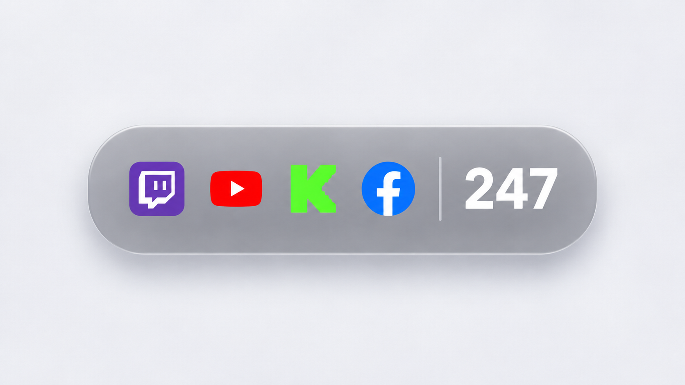
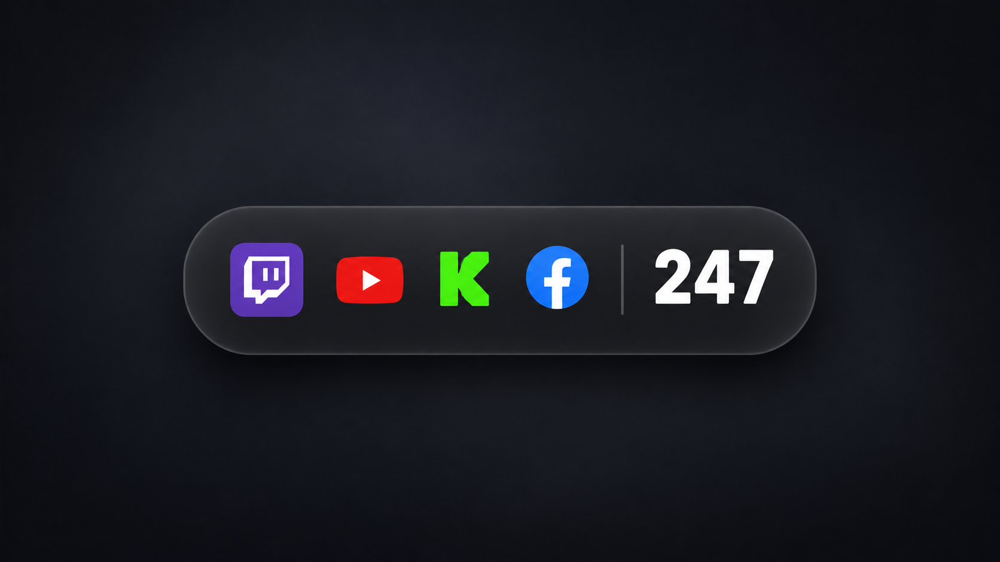

# Botriquis — Contador de Espectadores Translúcido

**Botriquis** é uma personalização horizontal e compacta do widget **Contador de espectadores** da Streamlabs. Exibe os ícones das plataformas conectadas à esquerda e **o total somado de espectadores** à direita, em uma única cápsula translúcida.

**Autoria, conceito, personalização e publicação:** Leonardo — **Guia do Streamer**.  
**Desenvolvimento técnico:** com auxílio de inteligência artificial.  
**Versão:** `v1.0.0` — 11 de novembro de 2026.  
**Repositório oficial:** https://github.com/guiadostreamer/contador-espectadores-pequeno-botriquis

## Prévia das duas versões

O Botriquis possui **duas opções visuais**, permitindo escolher o estilo que melhor combina com o cenário da transmissão.

### 1. Versão clara — Original



Visual cinza-claro translúcido, com ícones coloridos das plataformas e total de espectadores em destaque.

**Arquivo CSS:** `css_01_original_claro.txt`

### 2. Versão preta — Transparente



Visual preto com baixa opacidade, ideal para quem prefere um contador mais discreto, permitindo visualizar o cenário da transmissão por trás do widget.

**Arquivo CSS:** `css_02_preto_transparente.txt`

> **Importante:** as duas versões utilizam o mesmo HTML e JavaScript. Para alternar entre elas, basta substituir o conteúdo da aba CSS na Streamlabs.

---

## Características

- Painel horizontal pequeno, com **um único fundo**, sem moldura extra ou textura de traços.
- **Duas versões visuais:** claro original e preto quase transparente.
- Opacidade personalizável e fundo externo transparente para uso no OBS Studio.
- Ícones personalizados de Kick, YouTube, Twitch e Facebook, incluindo o **ícone roxo e branco da Twitch fornecido pelo autor e incorporado diretamente no CSS**. O Facebook usa o clássico “f” branco sobre fundo azul.
- Total geral em destaque; contagens de cada plataforma permanecem ocultas visualmente, **mas continuam no DOM** para a soma.
- Animação discreta na mudança dos valores e preferência `prefers-reduced-motion` respeitada.
- Sem conta extra, API própria, token ou conexão paralela aos chats.

O Facebook está **preparado no CSS**: quando a Streamlabs inserir uma plataforma identificada como `facebook` ou `facebook_account`, o ícone azul com “f” branco será exibido.

## Como funciona

**A Streamlabs fornece a mecânica do contador.** O template `#platform_item` é processado pela Streamlabs, que adiciona as plataformas habilitadas em `#platform_container` e atualiza seus números. O JavaScript observa esse contêiner via `MutationObserver`, lê cada valor pela classe `.platform-source-count`, soma e atualiza `#total_count` com uma transição numérica suave. **A mecânica de soma e atualização segue a implementação do [Square Total](https://github.com/guiadostreamer/contador-espec-square-total), testada ao vivo pelo autor.** O CSS determina a apresentação; os contadores individuais continuam ocultos visualmente, mas disponíveis para a soma.

O total depende dos números que a Streamlabs entregar; plataformas desconectadas, offline ou com atraso podem exibir zero ou resultados temporariamente incompletos. **O Botriquis não coleta dados diretamente das plataformas.**

## Instalação na Streamlabs

1. Acesse a **Streamlabs → Todos os widgets → Contador de espectadores**.
2. Ative a personalização de **HTML/CSS** (e JS, conforme o painel).
3. Copie **todo** o conteúdo de `html.txt` para a aba **HTML**.
4. **Escolha uma das duas versões visuais:**
   - `css_01_original_claro.txt` — versão clara original.
   - `css_02_preto_transparente.txt` — versão preta quase transparente.
5. Copie **todo** o conteúdo do arquivo CSS escolhido para a aba **CSS**.
6. Copie **todo** o conteúdo de `js.txt` para a aba **JS**.
7. Marque as plataformas desejadas e configure o fundo do widget como **transparente**.
8. Salve e atualize a fonte de navegador no OBS Studio.

**OBS Studio:** como ponto de partida, use fonte de navegador de **560 × 120 px**. Ajuste a resolução da própria fonte para evitar aumentar um widget minúsculo com a transformação da cena, o que pode causar embaçamento. O espaço não usado permanece transparente.

## Escolha entre dois fundos

O Botriquis possui duas opções visuais que utilizam exatamente o mesmo HTML e JavaScript.

### 1. Claro (original)

**Arquivo:** `css_01_original_claro.txt`

Mantém o visual original aprovado, com uma cápsula cinza-clara translúcida, ícones coloridos das plataformas e número total branco em destaque.

### 2. Preto quase transparente

**Arquivo:** `css_02_preto_transparente.txt`

Apresenta uma cápsula preta com **22% de opacidade**, sem segunda camada, sem traços e sem alterar tamanhos, ícones ou contagem.

Para alternar entre os temas, basta substituir **somente o conteúdo da aba CSS** na Streamlabs pelo arquivo da versão desejada.

**Não é necessário alterar o HTML nem o JavaScript.**

No topo do CSS escuro, altere:

```css
--capsule-bg: rgba(0, 0, 0, 0.22);
```

Você pode experimentar:

- `0.15` — fundo ainda mais transparente.
- `0.22` — transparência padrão.
- `0.35` — fundo preto mais visível.

O fundo externo permanece inteiramente transparente.

## Ajustes rápidos de aparência

Abra o arquivo CSS da versão escolhida e altere as variáveis em `:root`, principalmente:

| Variável | Função |
| --- | --- |
| `--capsule-bg` | Opacidade da cápsula (cor `rgba`) |
| `--total-size` | Tamanho do número total |
| `--icon-size` | Tamanho dos ícones |
| `--gap-platforms` | Espaçamento entre plataformas |
| `--gap-total` | Espaçamento entre ícones e total |
| `--capsule-radius` | Arredondamento |

A versão clara também utiliza uma cor fixa na primeira parada do `linear-gradient` dentro de `.botriquis-capsule`; altere-a se quiser que **todo o fundo** acompanhe a nova transparência.

## Arquivos

```text
contador-espectadores-pequeno-botriquis/
├── html.txt                              # Estrutura e template nativo
├── css_01_original_claro.txt             # Versão clara original
├── css_02_preto_transparente.txt         # Versão preta quase transparente
├── js.txt                                # Observação e soma do contador
├── preview-botriquis-claro.png           # Prévia da versão clara
├── preview-botriquis-preto-transparente.png # Prévia da versão preta
├── README.md                             # Apresentação e instalação
├── LICENSE.txt                           # Licença de uso gratuito com restrições
└── CHANGELOG.md                          # Histórico de versões
```

**Importante:** utilize apenas **um arquivo CSS por vez**. Os dois temas são alternativas visuais do mesmo widget e não devem ser combinados na aba CSS.

## Licença de uso

**Gratuito para uso em transmissões próprias, inclusive monetizadas.** É permitido personalizar para uso pessoal. **Não é permitida a redistribuição, o reupload, a revenda ou a publicação de versões derivadas sem autorização prévia e escrita do titular.**

Leia os termos completos em [LICENSE.txt](LICENSE.txt).

Repositório público **não** significa domínio público nem licença de software livre.

## Direitos de terceiros e compatibilidade

Streamlabs, Kick, Twitch, YouTube, Facebook e demais marcas, produtos, ícones e serviços pertencem aos respectivos titulares. O projeto é independente e não implica afiliação ou endosso oficial.

O Botriquis foi **testado ao vivo pelo autor**. Sua lógica de leitura, soma, inicialização, observação e animação está alinhada ao Square Total, também validado em transmissão ao vivo pelo Guia do Streamer. O funcionamento e a disponibilidade dos dados dependem das integrações oferecidas pela Streamlabs e podem variar após atualizações da plataforma.
